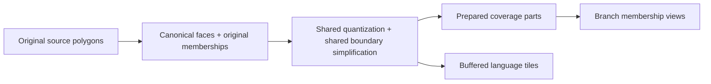

# Interactive atlas of the world's languages

The browser application lives in `app/`. Geography explores the Glottolog,
Glottography, and Digital Language Atlas of China catalogs and areas. Word histories
searches DiACL forms, recorded relationships, and concept comparisons, with an
optional focal-point overlay alongside pinned atlas areas.

## Run with published data

Use Python 3.12+, the authenticated GitHub CLI, and Node.js 24+. From the repository
root, restore the three independently pinned browser bundles:

```sh
python3 -m pipeline.atlas.data_release restore
python3 -m pipeline.etymology.data_release restore
python3 -m pipeline.wals.data_release restore
cd app
npm ci
npm run dev
```

Open **Word histories** in the header. Each workspace loads its data on first use.
See [frontend interactions and checks](app/README.md#word-histories) and
[lexical source and release contracts](pipeline/etymology/README.md).
The offline build below is for changing geographic data.

The WALS port provides published data delivery, a reproducible offline adapter,
a validated lazy repository, conservative catalog associations and source-aware
session/navigation contracts. Open a language profile and choose **Load WALS features**
to see recorded varieties, feature cards and citations. Variety choices survive profile
and workspace navigation for the session; shared-feature map exploration is a later step.
See [source/build commands](pipeline/wals/README.md),
[frontend contracts](app/src/features/wals/README.md) and the [port roadmap](WALS_PORT_PLAN.md).
It uses an independent pinned snapshot and does not rebuild geographic or lexical data.

## Build the proof of concept

```sh
bash ./pipeline/atlas/fetch-sources.sh
uv sync
bash ./pipeline/atlas/bootstrap-tippecanoe.sh
uv run python -m pipeline.atlas.build
cd app
npm install
npm run precompute:branches
npm run precompute:colors
npm run dev
```

Generated browser artifacts are written to `app/public/data/` and are not
committed. The normalized intermediate geometry is written to `data/processed/`.
External datasets and Tippecanoe are fetched at the exact revisions recorded in
`pipeline/atlas/sources.lock.tsv`; DLAC's Dataverse files are pinned by file ID and
SHA-256 in `pipeline/dlac/fetch.sh` and fetched by the same source-fetch command.
The atlas build converts DLAC's shapefile automatically. See
[DLAC's mapping and reuse policy](DATASETS.md#44-language-atlas-of-china), including
the conflicting CC0/BY-NC-SA metadata and the conservative noncommercial terms
used for its contribution. The build distributes a source notice beside the data.

The searchable catalog includes every Glottolog languoid: families and subfamilies,
languages, and dialects. It also includes source-defined entries without an
equivalent Glottocode, currently DLAC's Tibeto-Burman, Shaozhou Tuhua, and Danzhou.
These have stable dataset-namespaced IDs, retain the source's labels and scope,
and are identified in Explore, Details, and map inspection. Reviewed parent links
place Tibeto-Burman under Sino-Tibetan, and Shaozhou Tuhua and Danzhou under
Sinitic. Family metadata follows this ancestry. Entries with unresolved broader
affiliations remain roots; existing Glottolog branches keep their parents.
Search accepts primary and alternative names, ISO codes, Glottocodes, and catalog
IDs. Without a query, the compact tree starts at top-level families,
isolates, and other parentless entries. Search ranks direct names and identifiers
before partial matches and lets any languoid start an expandable subtree. An
ancestor's name supplies context rather than matching all its descendants.
Expanding a result shows all its immediate children, including entries without
polygons and names that do not match the query. Counts and bulk selection refer
to starting entries (roots or matches), independently of unfolded descendants.

Glottolog's `values.csv` classification paths supply immediate `parentId` links;
these include intermediate subfamilies and nested dialect groups. The separate
`parentLanguageId` remains the language-level ancestor of a dialect. The details
panel shows clickable ancestry and geographic sources, and "Show in classification"
reveals a result within its full tree. Arrow keys navigate/unfold branches, Home
and End move through the list, and Space toggles the focused entry's map area.

Each row shows its map representation: "Own area" for directly supplied polygons,
"Descendant areas" for an aggregation, "Filtered out" for geography hidden by the
current sources/period, or "No areas" when the entire branch has no polygons.
Entries with both representations have an inline selector; the details panel also
offers this choice. Own areas are the default when available. Otherwise, available
descendant areas make an entry selectable. Selecting an entry remembers its chosen
representation across filter changes; unavailable selections stay checked and can
be removed or switched to the other representation.

Aggregation starts with the entry's children and uses the first available polygon
source down each branch. A mapped child's dialects are not added again. Source and
period filters, and each contributor's geographic-source override, apply before
choosing this frontier. The details panel lists contributors, source provenance,
and uncovered branches; the aggregation represents available coverage, rather
than an inferred complete extent. Geometry is unioned per selected entry in the
map worker and displayed with one color and one checkbox. A contributor can still
be selected separately. Both hatching and blending preserve the grouped coverage.
Large aggregations use the existing geometry budgets and solid-area fallback.

Expansion and map selection are independent; aggregating a family does not check
its descendants individually. Entries without available areas remain searchable
and expandable.

To show an entry and its individually colored descendants, choose **Show branch
on map (N)** in Details, or **Show branches on map (N)** for the current Explore
roots/matches. The action visits collapsed branches and selects every entry with
its own polygon for the chosen sources and period, including mapped ancestors.
Within this branch view, descendants replace ancestor colors only where their
areas overlap. Halh therefore retains its broader area around Dariganga. Sibling
and unrelated-language overlaps remain stripes or blends. Broader fill identifies
geography supplied at that classification level, not an inferred individual language.
Unmapped branches contribute no invented coverage.

The action replaces entries in these branches from the same source/period context;
other comparison contexts stay selected. Entries retain their polygons, colors,
and source provenance, even when descendants fully cover their displayed fill.
Removing a descendant exposes available ancestor fill again. Repeating the action
preserves existing entry identities and colors. Source and period choices affect
the next action; they do not change already pinned entries.

`npm run precompute:branches` optionally prepares complete **single-dataset,
single-period** views at zooms 0–3. It composes the atlas build's reusable parts and
resumes completed tiles. Missing parts must be restored before preparing branches.
The browser uses these tiles only for an exact geometry/refinement match.

`npm run precompute:colors` builds the geometry-based semantic palette for every
dataset/period and embeds compact tables with dataset descriptions in the initial
metadata. Run it before serving or packaging the app: the catalog is ready only
once this metadata has loaded and validated. Selection and dataset switches then
choose colors synchronously, without palette requests. Mixed datasets/periods and
custom roots use catalog defaults; explicit regional optimization remains available.
Regenerate metadata after rebuilding catalogs, branch tiles, or the color policy.
The builder publishes `dataset-metadata/<hash>.json` and updates the manifest locally
under `public/data/`. `node scripts/precompute-colors.mjs --check` verifies every
embedded color against a fresh canonical solve.

The atlas build generates reusable disjoint coverage at all source zooms for
every dataset/period (currently 0–8). Each piece retains every original contributor,
including ancestors hidden in a branch view. Partial branches, child removal,
independent entries and descendant aggregates can therefore reuse the same
geometry: runtime work selects memberships and joins matching shared edges,
without general polygon unions, intersections or differences. Exact full branch
views still prefer the more compact prepared branch tiles. Mixed datasets or
periods, unprepared zooms and missing optional assets use the bounded live engine.
Run branch preparation again after regenerating atlas data, before publishing a
data release. Deployment reuses the published bundle without preprocessing.
`npm run precompute:parts` restores missing coverage from the common
canonical/LOD caches. To limit restoration, use e.g.
`npm run precompute:parts -- --dataset asher2007world --period contemporary --max-zoom 6`.
Filtered restoration preserves other completed profiles and never downgrades
higher-detail preparation. Each restored zoom's index is published atomically;
interrupted runs reuse cached geometry. Empty areas are recorded in a small
availability index instead of individual files. Indexes and parts load only for
the active dataset/period
and viewport; each profile has its own prepared zoom limit (up to source zoom 8).
The default has no dataset-specific exceptions: both Asher periods and every
other profile receive all source levels. The browser can therefore compose
single-profile full views, subsets and aggregates at intermediate zooms without
live polygon overlay. `npm run test:prepared-browser` covers dense Asher regions,
world-to-regional navigation, subsets, both periods, and the other datasets.
When visited tiles consume the receiver's position or pattern budget, offscreen
history is evicted before rejecting visible coverage. This keeps the current
view's detail and leaves worker caches available for return pans.

Language geometry is exported by dataset/period into PMTiles archives. The
browser requests ranges only from archives required by the current browsing
filters and pinned entries. Pinned comparisons retain their original sources
and periods. Mixed-source tiles are assembled in a worker before live overlap
calculation. The combined archive packages the same profile tiles for offline tools.

`uv run python -m pipeline.atlas.build` constructs one
high-precision disjoint partition per dataset/period **before** generating LODs.
Each face keeps its original variant memberships, including hidden ancestors.
Native Shapely/GEOS nodes the shared boundary network; LOD generation resolves
coordinate collapse in that network at extent 8192, adds common tile cuts, and
simplifies shared edges together. Coverage boundaries (coastlines and genuinely
uncovered regions) use a tighter tolerance than internal language borders.

Prepared parts and buffered language geometry are exported from the same LOD
faces. Language polygons are assembled from their contributing faces after
buffer clipping, so their tile interiors agree with the prepared parts. Branch
tiles are then membership/refinement views of those parts; they require no new
language-to-language overlay. `npm run precompute:parts` restores missing assets
from cached canonical/LOD geometry. Preprocessing uses this single shared topology
throughout; display tiles are never partitioned again to generate prepared parts.



The shared-coverage builder is the sole language preprocessing pipeline.
Geometry size and offline cost remain active tuning work.
The first full-data pass built all seven profiles through zoom 8 and passed the
prepared-coverage, navigation and inspection browser suites. Decoded checks
validated 51 coarse Asher tiles and 55 additional fine/profile tiles, with exact
source/parts footprint agreement. Five delayed LOD transitions sampled 370 frames;
another 2,098 navigation frames retained coverage. Hover samples were 8–42 ms in
software Firefox on the development host. These are observations, not device targets.
The combined archive grew from about 29 MB to 64 MB. The largest measured view
used 330,875 output positions, requiring the shared worker/receiver bound to rise
from 300k to 600k. Other runtime limits remain in place.

To experiment without replacing the app's data, run
`uv run python -m pipeline.atlas.topology_build --dataset asher2007world --period contemporary`.
Its default output is `data/processed/topology-preview/`; omit the profile filters
to generate all profiles. `--max-zoom`, `--tolerance-pixels`, and
`--boundary-tolerance-pixels` allow bounded comparisons. The geometry manifest
identifies immutable profile archives and parts; its `geometryBuild.report`
records the settings, source repairs, and per-level positions/bytes. The command
also exports a matching, profile-filtered catalogue for an isolated frontend
preview. `geometryMaxZoom` makes reduced-detail builds overzoom their last
available LOD rather than request missing higher levels.
Both coverage scripts accept `--data-dir` to operate on the isolated export.
The completed local preview can be opened from `app/` with
`npm run preview -- --outDir test-results/topology/site`. Validation reports and
screenshots are under `app/test-results/topology/`; these generated artifacts
are ignored by Git. A normal atlas rebuild installs this architecture into
`public/data/`; no pipeline-selection flag is needed.

Canonical geometry and completed LODs are cached separately under
`data/processed/topology/`. Regional source subdivisions accelerate ambiguous
membership transfer at the canonical centimetre-scale precision; they do not set
the visible LOD shape. Invalid source polygons are repaired with GEOS linework
MakeValid and recorded by variant/feature/reason in the report. The normalized
source records and provenance remain available. Small regions can still collapse
at final vector-tile precision; ambiguous surviving overlaps retain contributors,
and unassigned regions use original area majorities, counting uncovered area.
Complex shell/hole point contacts are decomposed without moving their boundaries.

`topology_cache.py` owns the lazy `get_or_build_lod` path used by both generation
and restoration. Canonical geometry is keyed by each profile's normalized records;
LODs and tile exports additionally depend on simplification settings. Maximum zoom
only enters archive keys, so extending a build reuses completed lower levels and
changing another profile preserves unchanged profiles' caches and asset URLs.

The directories under `data/processed/topology/` are `canonical/`, `lod/`, `tiles/`,
`archives/`, and `bundles/`. Public parts live under
`coverage-parts/<profile-key>/<dataset>/<period>/`; profile archives use
`geometry/<archive-key>/<dataset>/<period>.pmtiles`. Completed builds check that
expected files and indexes exist before starting workers, loading geometry or
packaging. Missing outputs are rebuilt from cached exports or the shared LODs.

These are disposable build products: there is no cache migration, format
versioning or corruption recovery. After changing preprocessing code or geometry
dependencies, delete `data/processed/topology/` and `app/public/data/`, then rerun
the normal build command. Source and simplification-setting changes are detected
automatically.

Generation runs independent dataset/period profiles in separate processes, using
up to two workers by default. Larger inputs start first. Use
`uv run python -m pipeline.atlas.build --jobs 4` to increase concurrency or
`--jobs 1` for a serial build; the standalone `pipeline.atlas.topology_build`
command accepts the same option. Each worker owns its profile's caches, database,
and output files. LODs within that profile stay sequential to reuse its canonical
partition and regional area index. Additional workers increase memory use, so the
default does not automatically consume every CPU. Source spooling happens before
the workers start; archive merging, when needed, and manifest publication happen
after they finish. Fully reused profiles start no workers. Scheduling does not
change geometry fingerprints or tile ordering.
Reports include the worker count and timings for preparation, each profile's
canonical geometry, individual LODs (including cache reuse), packaging, and final
merging. Parts restoration and branch-view materialization remain sequential;
they reuse the expensive shared geometry rather than rebuilding it.
An initial cold-cache comparison of Bouckaert, Wurm, Matsumae and DLAC through
zoom 4 took 199 s with one worker and 145 s with two (about 27% less wall time).
All 162 prepared tiles and 165 source tiles matched byte-for-byte. That batch was
dominated by one profile; this is not a full Asher build-speed measurement.
The local report is `app/test-results/topology/parallel-benchmark.json`.

Search, hierarchy, availability and source labels remain eager metadata. The
browser uses `geometry-index.json`; full source feature identifiers load per
dataset/period only when **Original source records** is expanded in Details.

Source and period controls live under "Sources & period" in Explore, alongside
search-area scope. They affect geography available to browse and add; existing
map entries retain their pinned sources and periods. Viewport scope limits
starting results, including aggregates with contributing areas in view; expanded
branches still show their full classification children.
Each row and map inspection identifies the classification level.

The pipeline imports the existing Glottography language, family, and dialect
areas, then uses original `features.geojson` polygons for entries not covered by
those prepared layers. Original polygon identities remain in the catalog and
provenance; the integrated builder assembles display geometry per variant. Explicitly
shared source polygons retain each referenced languoid. The pipeline preserves
source geometry; optional descendant aggregation happens in the browser rather
than creating new dataset records. Geometry variants record their input
file, source feature IDs, and whether they use original or dataset-prepared areas.
Unassigned features are omitted; identifiers absent from the atlas catalog are
reported as build warnings. Existing file and vector-layer names
(`languages.json`, `language_areas`) also cover families, dialects, and source
groups. Catalog schema version 5 adds explicit `classification` provenance:
`{kind: "glottolog", glottocode}` or `{kind: "source", datasetId, label, note}`.
`id` is an opaque catalog key, independent of external identifiers. The schema
retains immediate `parentId` links, `languoidCount`, and `languoidWithGeometryCount`.
Source entries are registered in `pipeline/atlas/source_languoids.json`; adding
one requires a reviewed registry entry and importer assignment. Registry checks
reject duplicate IDs, unknown datasets/parents, and classification cycles.

The generated geometry catalog preserves four temporal source views:

- contemporary areas from Asher, Wurm and Hattori's Pacific atlas, Matsumae's
  Northeast Asian dataset, and DLAC's regional China source (labeled 1985–1987);
- Asher time-of-contact areas, with contemporary proxies explicitly marked;
- the DiACL polygon archive's approximate 1750 snapshot;
- Bouckaert's mixed modern-and-ancient Indo-European source view.

Publication years are stored separately from represented geographic periods.
The frontend period selector never substitutes geometry from another period
when the selected view has no area for a language.

Language-area polygons and their catalog are served locally from `app/public/data/`.
Background choices are Plain, Biomes, Terrain, and Satellite. Plain uses
OpenFreeMap water geometry; Terrain uses EOX raster tiles; Satellite uses NASA
Blue Marble via GIBS. Biomes uses a local RESOLVE 2017 vector archive with muted
colors for 14 biome categories; see [its source and rebuild instructions](app/public/basemaps/README.md).
The Google Fonts import is also remote and can be replaced with self-hosted font
files for a fully offline build.

The frontend can then be checked with:

```sh
cd app
npm run check
npm run typecheck
npm run build
```

Pipeline regressions can be checked with `uv run pytest`.

## Overlap rendering

The map defaults to **Alternating stripes**: shared areas cycle through the
colors of all selected languages covering them. Select languages in the language
panel and choose **Alternating stripes** or **Color blending** in Map settings.
Hover and click inspect the displayed regions, including all contributors to an
overlap at the displayed detail level.

**Color intensity** defaults to 82% and can be adjusted between 40% and 100%.
Solid areas and overlap stripes share the same transparency. They are composited
once over the basemap, so transparent stripes do not reveal other language fills
underneath. Adjusting the slider does not recompute geometry.

**Language colors** uses stable genealogy palettes. In Map settings,
**Optimize colors for this view** adapts the palette to the selected polygons on
screen. Prominent and neighboring families receive coherent palettes. Internal
variation follows each family's neighborhood, using available shade differences
to retain broad branch structure in crowded views and expand focused comparisons.
Refresh updates offscreen relatives with the same family palette. Colors remain
fixed while navigating or changing filters. Custom colors are kept;
**Undo colors** and **Use default palette** restore earlier assignments. These
settings last until reload. Defaults and view optimization share the same shade
allocator; fixed catalog evidence keeps defaults stable. Independent evaluation
checks local conflicts and branch contrast at several area scales. See
[the color algorithm, roadmap, controls, and evaluation commands](app/src/domain/COLORS.md).

Overlap geometry is computed in a browser worker from the existing PMTiles
archive, using its simplified vector tiles and a spatial index. Exact complete
dataset views and same-dataset/period subsets can use the optional prepared coverage described above; no server
is required. Computation updates after navigation;
tile geometry and overlap results are cached. Multi-language intersections are
partitioned into disjoint regions before drawing, so triple overlaps retain all
three colors rather than stacking pairwise patterns.

This preview uses zoom-dependent map geometry, not full-resolution boundaries
for geographic analysis. It limits viewport work and geometry complexity;
when a limit is reached, a message asks you to zoom in or select fewer languages,
and available coverage remains visible. Loading and errors appear on the map;
**Retry** reuses completed tiles. Single-language regions use native solid fills,
and shared regions use stripe textures. Pattern spacing follows
MapLibre's map-anchored image fills. See the
[implementation notes](app/src/features/map/overlap/README.md) for details.
The [overlap roadmap](OVERLAP_ROADMAP.md) tracks limitations, priorities, and
completion criteria for future sessions.

Run the overlap checks with Node 24 or newer:

```sh
cd app
npm test
```

The real-archive integration test runs when generated atlas data is present;
the synthetic geometry tests run without it.

## Deploy to GitHub Pages

The `Deploy to GitHub Pages` workflow downloads the prebuilt data selected by
`data-release.json` and independently pinned lexical data in
`etymology-release.json`, verifies their checksums, then tests, builds and deploys the Vite
application whenever `main` is pushed. Deployment does not fetch source datasets,
install Python pipeline dependencies, build Tippecanoe, or run preprocessing.
Generated browser data lives in GitHub Release assets, outside Git history.

To publish new data, first run the full atlas build, branch preparation, and palette
preparation commands from the setup instructions on a suitable development/build
machine. Record the full Git commit used for that build; commit changes to data-producing code before
generating release data. Then, from the repository root:

```sh
python3 -m pipeline.atlas.data_release audit
python3 -m pipeline.atlas.data_release pack \
  --tag atlas-data-YYYY-MM-DD \
  --pipeline-commit FULL_BUILD_COMMIT \
  --output .data-releases/atlas-data-YYYY-MM-DD
python3 -m pipeline.atlas.data_release publish \
  .data-releases/atlas-data-YYYY-MM-DD/data-release.json
```

Use a new tag for every data publication. Packaging follows the current manifest,
profile indexes, and branch signatures; old archives, old index snapshots,
unindexed tiles and interrupted writes are excluded. Missing referenced files,
incomplete tile indexes and mismatched catalog counts stop packaging. The bundle
retains the combined archive and detailed geometry catalog for offline tools and
integration tests, as well as prepared palettes, notices, provenance and the geometry
build report.
The audit reports selected and excluded **logical file bytes**; disk usage can
differ because of hard links, compression or filesystem allocation.

Publishing requires GitHub CLI authentication (`gh auth login`) with permission
to create releases and upload assets (`contents: write` for a fine-grained token).
It creates a draft, uploads the bundle and reference file, then publishes the
release and updates the local `data-release.json`. Commit and push that small
reference together with any application changes. Ordinary deployments need only
the workflow's existing `contents: read` permission and automatic `GITHUB_TOKEN`;
no additional deployment secret is required. A failed download or verification
fails deployment instead of rebuilding data. If publication fails, the existing
pin remains unchanged; remove any incomplete draft before retrying.

For existing prepared data whose build commit was never recorded, explicitly use
`--pipeline-commit unknown`. The pin then records `pipelineCommit: null` and the
packaging checkout separately, without attributing the build to that checkout.

To test a bundle locally, restore it into an empty directory:

```sh
python3 -m pipeline.atlas.data_release install \
  .data-releases/atlas-data-YYYY-MM-DD/atlas-data.tar.gz \
  --pin .data-releases/atlas-data-YYYY-MM-DD/data-release.json \
  --output /tmp/atlas-release-preview
```

`python3 -m pipeline.atlas.data_release restore` downloads the pinned release into
an empty `app/public/data/`; `--output` selects another directory. Installation
checks the checksum and complete referenced file set before exposing the result.
It refuses to overwrite existing data. Roll back by restoring an earlier
`data-release.json` in Git. Keep any release referenced by a deployed revision.
There are no data migrations: rebuild and publish a new bundle when needed.

Before the first deployment, open the repository's **Settings → Pages** and set
**Source** to **GitHub Actions**. The project site is built with `/lang-viz/` as
its base path and is published at `https://maximemulder.github.io/lang-viz/`.

Word histories use a separately versioned browser bundle and raw-source archive.
See [lexical restoration and publication](pipeline/etymology/README.md#independent-release-delivery).
The selected lexical release is published and supports clean-checkout restoration.
Lexical updates never require rebuilding or republishing the geographic bundle.
